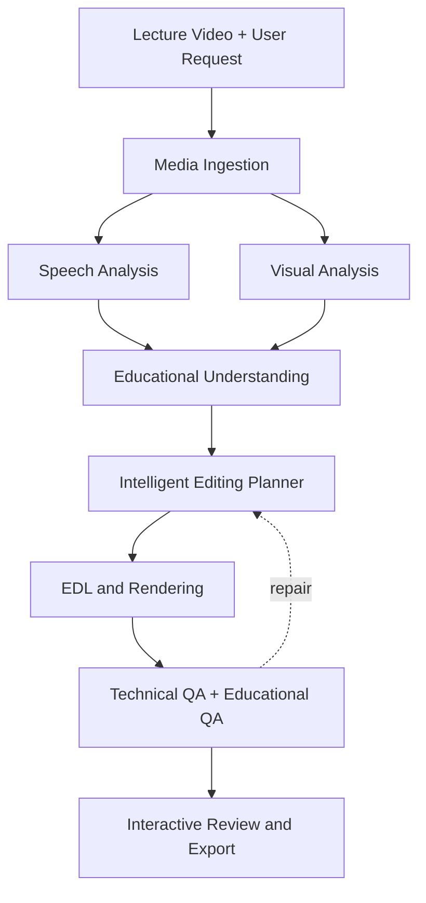
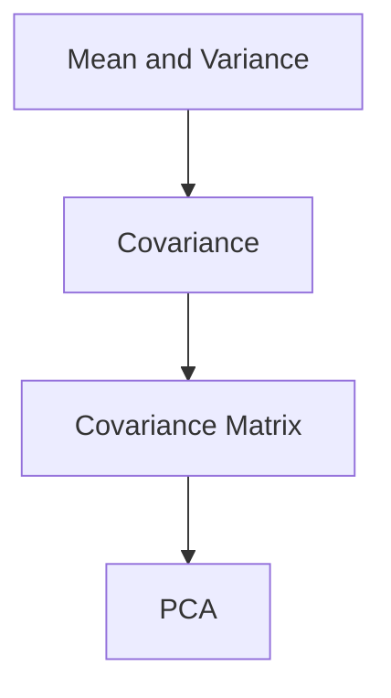

# AI Lecture Editor — Step-by-Step Implementation Roadmap

**Recommended approach:** Use Plan 1 as the engineering foundation, Plan 3's scope and research discipline, and selected innovations from Plan 2 as later extensions.

**Target schedule:** 24 weeks  
**Primary goal:** Build an evidence-grounded, pedagogy-aware system that creates shorter educational videos while preserving important concepts, prerequisite order, and explanation quality.

---

## 1. Project goal

The system accepts a lecture video and a natural-language editing request, for example:

> Reduce this 60-minute lecture to 25 minutes. Preserve all important definitions, the main explanations, and at least one worked example for each major topic. Remove repetition and unnecessary pauses.

The system should:

1. Inspect and ingest the source video safely.
2. Analyze speech and visual content.
3. Organize the lecture into teaching units.
4. Extract concepts and evidence-backed prerequisite relationships.
5. Select material according to the user's goals and duration constraints.
6. Generate an edit decision list (EDL).
7. Render the edited video.
8. Verify technical and educational quality.
9. Let a user review and modify the result.

### High-level architecture



The system should be one controlled application with distinct processing stages, not three separate repository architectures stitched together.

---

## 2. How the three repositories fit

The repositories have different responsibilities. Borrow useful patterns; do not blindly adopt their entire architectures.

### OpenMontage — pipeline orchestration and production workflow

Repository: <https://github.com/OpenMontageInc/OpenMontage>

Useful ideas to study and adapt:

- Declarative pipeline manifests.
- Stage-specific inputs, outputs, and success criteria.
- Artifact validation and checkpointing.
- Human approval gates.
- Bounded stage revisions and execution limits.
- Review workflows and production status visibility.

Do not adopt the entire agentic production framework unless the project later demonstrates a need for it.

### ffmpeg-skill — media operations and rendering safety

Repository: <https://github.com/kajisho5/ffmpeg-skill>

Useful ideas to study and adapt:

- Typed media operations and clear input validation.
- Safe FFmpeg argument construction.
- Lossless-first editing where appropriate.
- Temporary output files and protection against overwriting inputs.
- Output probing and verification.
- Structured failures and useful diagnostics.

Do not implement every available tool or adopt its complete MCP/tool architecture just because it exists.

### rea-video — visual analysis and evidence handling

Repository: <https://github.com/JuneYaooo/rea-video>

Useful ideas to study and adapt:

- Separating deterministic visual measurements from model interpretation.
- Recording evidence and confidence.
- Treating model-generated visual interpretations cautiously.
- Routing disagreements or uncertain cases to review.
- Reusing cached measurements when classification rules change.

Important distinction: rea-video is not an educational concept extractor. The educational concept graph, prerequisite reasoning, and pedagogy-aware optimization are features to design and validate in this project.

### Repository-use rule

Adopt tested patterns and individual recipes, not entire architectures. Before copying code, inspect each repository's current license and dependencies. OpenMontage, ffmpeg-skill, and rea-video have different licensing terms; direct code reuse requires checking the relevant license and obligations. Ideas and independently implemented designs are not the same as copying source code.

---

## 3. Feature priorities

### Core features — required for the first complete research system

| Area | Feature | Main inspiration |
|---|---|---|
| Architecture | Pipeline manifest | OpenMontage |
| Architecture | Artifact schemas | OpenMontage |
| Architecture | Checkpoint management | OpenMontage |
| Architecture | Backend-enforced human approval | OpenMontage |
| Media | Safe media ingestion and probing | ffmpeg-skill-inspired |
| Media | EDL and deterministic renderer | ffmpeg-skill-inspired |
| Media | Source-to-output time mapping | Project architecture |
| Speech | Word-level transcription/alignment | Project architecture |
| Speech | VAD and conservative silence baseline | Project architecture |
| Visual | Scene and slide detection | rea-video-inspired |
| Visual | OCR and slide timeline | rea-video-inspired |
| Evidence | Evidence store with source references | rea-video-inspired |
| Education | Teaching-unit segmentation | Research contribution |
| Education | Concept extraction with evidence IDs | Research contribution |
| Education | Prerequisite graph | Research contribution |
| Planning | Greedy baseline | Research contribution |
| Planning | CP-SAT optimizer | Research contribution |
| QA | Deterministic technical QA | ffmpeg-skill-inspired |
| QA | Pedagogical QA | Research contribution |
| QA | Bounded local repair | Project architecture |
| Product | Basic review and editing interface | Project architecture |
| Evaluation | Labeled benchmark and ablation harness | Research methodology |

### Later extensions — do not block the first complete system

- Elastic teaching units with core and optional spans.
- Selective/on-demand VLM analysis.
- Slide-bridge overlays.
- Browser virtual composition player.
- Multiple alternative editing plans.
- Parallel chunk rendering.
- Arabic forced alignment and code-switching support.
- OpenTimelineIO export.
- Advanced caption styling and motion graphics.
- Generalization beyond educational lectures.

If Arabic is the primary thesis evaluation language, move Arabic support into the core scope and postpone another extension.

---

# Part A — Core implementation

## Phase 0 — Architecture, project foundation, and decisions

**Suggested timing:** Days 1–3  
**Priority:** Must-have

**Goal:** Establish a project structure that supports independent development, reproducible experiments, and reliable processing.

### Step 1: Create the project structure

```text
ai-lecture-editor/
│
├── backend/
│   ├── api/
│   ├── services/
│   ├── workers/
│   ├── database/
│   └── core/
│
├── schemas/
│   └── artifacts/
│
├── pipeline_defs/
│   └── lecture-edit.yaml
│
├── evaluation/
│   ├── datasets/
│   ├── annotations/
│   ├── benchmarks/
│   ├── experiments/
│   └── RESULTS.md
│
├── projects/
├── frontend/
├── tests/
└── docs/
    ├── architecture/
    ├── decisions/
    ├── research/
    └── references/
```

### Step 2: Establish architecture rules

1. **One application time unit:** use integer milliseconds (`start_ms`, `end_ms`, `duration_ms`) for application-level timestamps. Preserve original frame presentation timestamps and stream timebases for variable-frame-rate (VFR) media; milliseconds must not erase the source timing information.
2. **EDL is the source of truth:** the edit decision list describes the intended edit. Rendered videos are derived artifacts.
3. **Every stage creates an artifact:** downstream stages consume persisted outputs rather than relying only on in-memory state.
4. **Every artifact has a schema:** reject invalid artifacts before another stage consumes them.
5. **Important decisions are recorded:** maintain an append-only decision log with the decision, rationale, alternatives, and a test that protects the behavior.
6. **Human approval is enforced by the backend:** a frontend button or disabled control is not an approval security boundary.

### Step 3: Define the main artifacts

| Artifact | Purpose |
|---|---|
| `probe_report` | Original video and stream metadata |
| `transcript` | Words, sentences, timestamps, confidence |
| `visual_evidence` | Scenes, slides, OCR results, visual references |
| `knowledge_graph` | Teaching units, concepts, and prerequisites |
| `edit_plan` | Selected material and editing instructions |
| `render_report` | Rendering outcome and verification |
| `qa_report` | Technical and educational quality checks |

### Step 4: Implement stage management

Use a declarative pipeline manifest inspired by OpenMontage. Each stage should declare:

- Inputs and outputs.
- Required tools.
- Validation criteria.
- Whether human approval is required.
- Maximum revisions.
- Maximum execution time.
- Cache-key fields.

**Completion gate:** Create a project, execute a dummy stage, save and validate its artifact, and resume after an interrupted stage.

---

## Phase 1 — Dataset and evaluation foundation

**Suggested timing:** Weeks 1–2  
**Priority:** Must-have

**Goal:** Make it possible to measure whether the editor improves the editing process.

### Step 1: Collect lecture recordings

Start with three development lectures. Expand toward 10–15 diverse lectures if the annotation budget permits.

Include different conditions:

- Speaker talking with slides.
- Screen-recorded lectures.
- Mathematical explanations.
- Worked examples.
- Long pauses and repetitions.

Choose one primary language for the first benchmark unless Arabic is the main thesis target.

### Step 2: Annotate the lectures

For each lecture, label:

| Annotation | Example |
|---|---|
| Teaching-unit boundaries | 02:10–03:20 |
| Important concepts | Linear regression |
| Must-keep segments | Definition of the loss function |
| Removable segments | Repeated explanation |
| Prerequisites | Understanding residuals before mean squared error |
| Worked examples | Numerical regression example |
| Slide intervals | Equation displayed from 02:30–03:05 |

Have a second annotator review a subset so inter-annotator agreement can be measured.

### Step 3: Create the evaluation harness

| Metric | What it measures |
|---|---|
| Duration error | Difference between requested and actual duration |
| Decode success | Whether the output video decodes correctly |
| Mid-word cut rate | Whether edits interrupt words |
| Locked-content retention | Whether protected segments remain |
| Concept recall | Whether important concepts survive |
| Prerequisite violations | Whether retained concepts appear in a valid learning order |
| Boundary quality | Whether selected segments remain understandable |

Create a command that evaluates the current system and produces a results table.

**Completion gate:** A small labeled dataset exists, and the evaluation harness can run without manually calculating every result.

---

## Phase 2 — Media ingestion

**Suggested timing:** Weeks 2–3  
**Priority:** Must-have

**Goal:** Accept lecture recordings safely and generate the media files required by later stages.

### Step 1: Upload and validate

Check:

- Actual file signature, not only the extension.
- File size and duration limits.
- Supported codecs.
- Audio and video streams.
- Corrupted or invalid files.
- Unsafe playlist-like inputs and URLs.

Assign each uploaded video a unique ID. Store the original video as immutable input.

### Step 2: Probe the video

Extract:

- Duration.
- Resolution.
- Frame rate and average frame rate.
- Codec.
- Audio sample rate.
- Number of audio streams.
- Rotation.
- Timebase.
- VFR indication.

### Step 3: Generate derived media

| File | Purpose |
|---|---|
| `audio.wav` | Speech recognition input |
| `proxy.mp4` | Fast video analysis and browser playback |
| `metadata.json` | Original media information |
| `source_map.json` | Source timing information |

Use mono 16 kHz WAV as an initial ASR input format. Create a lower-resolution proxy for analysis while retaining the original for final rendering.

### Step 4: Implement caching

A cache key should include:

- Source identity or fingerprint.
- Processing stage.
- Model version.
- Configuration and relevant parameters.

Do not reuse stale results when a relevant input, model, or configuration changes.

**Implementation note:** A single-pass, multi-output FFmpeg pipeline may reduce repeated decoding, but do not make it mandatory before benchmarking. First create a stable pipeline, then compare the combined approach against separate processing stages.

**Completion gate:** A lecture can be uploaded, inspected, and converted into valid derived media without modifying the original.

---

## Phase 3 — Rendering engine and time mapping

**Suggested timing:** Weeks 2–4  
**Priority:** Must-have

**Goal:** Prove the system can edit videos correctly before introducing AI editing decisions.

### Step 1: Design the Edit Decision List

The EDL should describe:

- Source video identity.
- Retained source intervals.
- Output ordering.
- Audio treatment.
- Speed changes, if supported.
- Caption information.
- Overlay instructions, if supported.

Example of a manually authored EDL timeline:

| Clip | Source start | Source end | Operation |
|---|---:|---:|---|
| Clip 1 | 0 ms | 30,000 ms | Keep |
| Clip 2 | 45,000 ms | 90,000 ms | Keep |
| Clip 3 | 120,000 ms | 150,000 ms | Keep |

### Step 2: Implement a deterministic renderer

Adapt these media-engineering principles:

- Prefer stream-copy/lossless operations where appropriate.
- Re-encode only when required by the operation or accuracy needs.
- Use argument arrays rather than shell command strings.
- Validate input parameters.
- Preserve original files.
- Probe and verify output.
- Report warnings explicitly.

### Step 3: Implement source-to-output mapping

If source interval 30–45 seconds is removed, the output mapping becomes:

```text
Output 0–30 seconds  -> Source 0–30 seconds
Output 30–75 seconds -> Source 45–90 seconds
```

Persist this mapping. Captions, chapters, transcript synchronization, and QA depend on it.

### Step 4: Implement safe rendering

Add:

- Temporary output files.
- Atomic replacement after successful completion.
- Protection against overwriting the input.
- FFmpeg argument arrays.
- Process timeouts.
- Cleanup after failures.
- Source fingerprints checked before plan execution.

### Step 5: Add cut safety

A cut should not interrupt a spoken word. Use:

- Word boundaries.
- Sentence boundaries.
- Silence intervals.
- Boundary confidence.

Prefer snapping to a suitable nearby boundary rather than making arbitrary cuts. Add short audio fades only when needed to avoid audible clicks, and verify them by listening and testing.

**Completion gate — Gate 1:** A manually created three-clip EDL generates a valid MP4 with correct duration, synchronized audio, and an accurate source/output time map.

**Do not begin AI-based editing before passing this gate.**

---

## Phase 4 — Speech analysis

**Suggested timing:** Weeks 4–5  
**Priority:** Must-have

**Goal:** Understand what the lecturer says and when each word is spoken.

### Step 1: Automatic speech recognition

Use `faster-whisper` as an initial English transcription baseline. Store:

- Text.
- Segment start and end.
- Word start and end, when available.
- Confidence.
- Speaker information, if available.

Keep the original transcript immutable.

### Step 2: Word-level alignment

ASR output alone may not provide sufficiently reliable word boundaries. Use a forced-alignment stage where the language and model are supported. Store word intervals and alignment confidence.

### Step 3: Voice activity detection

Use VAD to identify:

- Speech.
- Silence.
- Long pauses.
- Possible speech hallucinations in silent regions.

### Step 4: Sentence segmentation

Organize the transcript into complete sentences. Track sentence boundaries, inter-sentence pauses, confidence, and relationships with surrounding speech.

### Step 5: Build the silence-removal baseline

Create B0: a conservative silence-removal editor.

Do not automatically remove every pause. Pauses may be important while the lecturer is writing a formula, drawing a diagram, showing code, or allowing students time to understand something.

### Step 6: Filler detection

Start with explicitly identified fillers. Do not automatically treat discourse markers such as “like” or “so” as removable; they can carry meaning. Keep filler removal optional, conservative, and logged.

**Completion gate:** The system can transcribe a lecture, produce word-level timestamps, identify silence, and generate a baseline edited video.

---

## Phase 5 — Visual analysis and slide understanding

**Suggested timing:** Weeks 6–7  
**Priority:** Must-have

**Goal:** Understand what is visible while the lecturer speaks.

### Step 1: Detect scene and slide changes

Use a scene detector such as PySceneDetect or equivalent methods, along with frame difference, histogram comparison, and perceptual hashing.

Do not treat every animation or mouse movement as a new slide.

### Step 2: Remove duplicate slide frames

Compare consecutive frames using pHash and SSIM. Merge frames representing the same slide, but preserve distinct versions when new annotations or meaningful changes appear.

### Step 3: Extract slide images

Save representative frames for each distinct slide interval and maintain the source interval represented by each slide.

### Step 4: Run OCR

Extract:

- Slide title.
- Bullet points.
- Equations.
- Code.
- Text positions/bounding boxes.
- OCR confidence.

PaddleOCR is one possible starting point.

### Step 5: Connect speech to visual information

For example, if the lecturer says, “As you can see in this equation…”, identify the slide displayed at that timestamp. Treat temporal overlap as a hypothesis, not proof that the slide explains the statement.

### Step 6: Build an evidence store

Each evidence item should include:

| Field | Example |
|---|---|
| Evidence ID | `EV_001` |
| Type | Speech |
| Source interval | 120,000–135,000 ms |
| Content | Explanation of MSE |
| Confidence | 0.94 |
| Source artifact | Transcript version 1 |

Visual evidence should be stored similarly, with references to source frames and slide intervals.

### Step 7: Implement feature caching

Separate expensive measurements from changeable reasoning.

**Expensive measurements:** extracted frames, OCR results, scene boundaries, audio features, and word timestamps.  
**Changeable reasoning:** slide interpretation, evidence fusion, concept classification, and scoring.

Changing a classification rule should not require decoding the original video again when the cached measurements remain valid.

**Completion gate:** A visual timeline contains unique slides, OCR information, timestamps, and links to relevant speech intervals.

---

## Phase 6 — Teaching-unit segmentation and educational understanding

**Suggested timing:** Weeks 8–9  
**Priority:** Must-have

**Goal:** Understand the lecture's educational structure, not merely its transcript.

### Step 1: Create teaching units

A teaching unit represents one coherent educational idea.

Example:

| Unit | Content | Role |
|---|---|---|
| TU1 | Introduction to PCA | Introduction |
| TU2 | Why dimensionality reduction is needed | Explanation |
| TU3 | Covariance matrix | Definition |
| TU4 | Eigenvectors and eigenvalues | Explanation |
| TU5 | PCA numerical example | Worked example |
| TU6 | PCA summary | Summary |

### Step 2: Segment the lecture

Use a combination of:

- Sentence boundaries.
- Embedding similarity.
- Slide changes.
- Topic transitions.
- Spoken cues.
- Pauses.

Do not rely exclusively on fixed-duration windows.

### Step 3: Classify teaching-unit roles

Initially support:

- Definition.
- Explanation.
- Worked example.
- Derivation.
- Summary.
- Introduction.

### Step 4: Extract concepts

Example:

```text
TU4:
- Eigenvectors
- Eigenvalues
- Principal components
```

Each extracted concept must reference actual evidence.

### Step 5: Build the prerequisite graph

Example:



Store each relationship with confidence and supporting evidence. Initially treat prerequisite relationships as suggestions or soft constraints. Only relationships supported by annotations and sufficiently reliable evidence should become hard optimization constraints.

### Step 6: Validate LLM output

The LLM may identify teaching units and propose concepts, but deterministic validation must ensure:

- It cannot invent evidence IDs.
- It cannot create arbitrary timestamps.
- It cannot create unsupported prerequisite edges.
- Every reference resolves to an actual artifact.

**Rule:** The LLM interprets evidence; deterministic code validates evidence references.

**Completion gate:** A human-checked concept benchmark exists, and each teaching unit has a coherent transcript, visual evidence, educational role, and associated concepts.

---

## Phase 7 — Intelligent editing planner

**Suggested timing:** Weeks 10–12  
**Priority:** Must-have

**Goal:** Automatically choose which teaching units should remain. This is the central optimization component of the thesis.

### Step 1: Understand the editing request

Convert a user's request into structured constraints such as:

```text
Target duration: 25 minutes

Must keep:
- PCA definition
- Covariance matrix
- Eigenvectors

Preferred:
- At least one numerical example

Remove:
- Repeated explanations
- Long unnecessary pauses
```

The language model should return concept IDs, role preferences, and numerical constraints—not arbitrary clip timestamps.

### Step 2: Calculate teaching-unit utility

Consider:

- Importance.
- Concept coverage.
- User preferences.
- Educational role.
- Evidence confidence.
- Redundancy.
- Cut safety.
- Relationships with other units.

### Step 3: Implement a greedy baseline

Create a simpler selection algorithm that chooses useful units until the duration budget is exhausted. Call it B1. Compare the optimizer against this baseline.

### Step 4: Implement CP-SAT

Use OR-Tools CP-SAT. The optimizer should handle:

| Constraint | Meaning |
|---|---|
| Duration | Stay within target tolerance |
| Must-keep | Preserve required concepts |
| User locks | Preserve selected units |
| Exclusions | Remove unwanted units |
| Prerequisites | Include required earlier concepts |
| Chronological order | Respect lecture sequence |
| Redundancy | Avoid repeated explanations |
| Continuity | Avoid excessive discontinuities |

### Step 5: Correctly model concept coverage

If two teaching units explain the same concept, selecting both must not earn the optimizer twice the concept reward. Use one coverage variable per concept; reward whether a concept is covered at least once.

### Step 6: Add educational utility

Reward required definitions, useful explanations, worked examples, requested derivations, and important summaries. Penalize repeated material, unnecessary transitions, excessive cuts, and poor boundary quality.

### Step 7: Handle prerequisites

If concept A is a confirmed prerequisite for concept B, selecting B should require an earlier selected unit that explains A. Do not impose hard constraints on weakly supported relationships.

### Step 8: Handle impossible requests

If the duration target conflicts with must-keep requirements, do not silently violate the constraints. Return:

- Why the request is infeasible.
- Minimum feasible duration, when calculable.
- Which requirements conflict.
- Suggested relaxation options.

### Step 9: Generate a validated editing plan

The optimizer returns selected unit IDs. A deterministic time resolver maps those IDs to safe source intervals and creates the EDL.

**Completion gate — Gate 2:** The system accepts a user request and produces a valid optimized EDL that passes deterministic validation.

---

## Phase 8 — Quality assurance and automatic repair

**Suggested timing:** Weeks 13–14  
**Priority:** Must-have

**Goal:** Ensure automatically edited lectures are technically correct and educationally meaningful.

### Layer 1: Technical QA

These checks should block delivery when they fail.

| Check | Expected result |
|---|---|
| Video decoding | Pass |
| Duration | Within tolerance |
| Audio/video synchronization | Pass |
| Source interval bounds | Valid |
| Cut boundaries | No mid-word cuts |
| Locked material | Preserved |
| Time mapping | Correct |
| Audio discontinuities | No unacceptable clicks or jumps |

### Layer 2: Educational QA

Check:

- Are important concepts retained?
- Are prerequisites satisfied?
- Is an example missing its conclusion?
- Does a retained explanation depend on removed material?
- Does a formula stay visible long enough?
- Are there abrupt topic transitions?

Semantic QA can produce findings and warnings. Deterministic technical failures should remain blocking.

### Step 3: Implement bounded repair

If QA finds that a worked example has lost its conclusion:

1. Identify the affected chapter.
2. Find the missing teaching unit.
3. Preserve unaffected selected units.
4. Update optimizer constraints.
5. Generate a new EDL.
6. Run QA again.

Limit automatic repair to two rounds initially. After that, request human review.

### Step 4: Version the plans

Every edit should create a new version, preserving its parent and a description of what changed.

```text
Plan v1 — Initial AI plan
Plan v2 — User locked two sections
Plan v3 — QA repair
Plan v4 — User restored an example
```

**Completion gate:** The system catches injected technical and educational defects, repairs localized problems, and preserves previous versions.

---

## Phase 9 — Basic editing studio

**Suggested timing:** Weeks 15–16  
**Priority:** Must-have

**Goal:** Give users control over the generated editing plan without building a sophisticated video editor too early.

### Step 1: Create the review interface

Display:

- Original video.
- Generated output preview.
- Transcript.
- Selected teaching units.
- Removed units.
- Reasons for each selection.
- Concept coverage.

### Step 2: Add basic controls

The user should be able to:

- Lock a teaching unit.
- Exclude a teaching unit.
- Restore removed material.
- Seek to a source timestamp.
- See why a unit was selected.
- Request another plan.

### Step 3: Synchronize the interface

When the user clicks a transcript sentence:

- The source video seeks to its timestamp.
- Its teaching unit becomes selected.
- Its associated slide appears.

### Step 4: Enforce human approvals

Approval must be checked by the backend, not merely by hiding or disabling a frontend button. Use the pipeline manifest and checkpoint system to enforce the gate.

### Step 5: Add React

Build the React interface after the review workflow is proven with a simpler page.

**Completion gate:** A user can review, modify, lock, and regenerate a plan without manually editing an EDL.

---

## Phase 10 — Scientific evaluation

**Suggested timing:** Weeks 17–20  
**Priority:** Must-have

**Goal:** Prove whether the proposed system improves lecture editing.

### Ablation structure

| Version | System | What it tests |
|---|---|---|
| B0 | Silence removal | Basic editing |
| B1 | Transcript-only greedy | Speech understanding |
| B2 | Transcript + slide OCR greedy | Visual information |
| B3 | Concept-aware greedy | Educational understanding |
| B4 | Concept-aware CP-SAT without prerequisites | Constrained optimization |
| B5 | Full system with verified prerequisites and QA | Complete research proposal |

### Metrics

| Metric | Research question |
|---|---|
| Weighted Concept Recall | Does the output preserve important knowledge? |
| Prerequisite Violation Rate | Does the output preserve learning order? |
| Duration Compliance | Does the output meet the requested duration? |
| Boundary Defect Rate | Are cuts coherent? |
| Technical Defect Rate | Does the output play correctly? |
| Human Preference | Do people prefer the educational quality of the output? |

### Human evaluation

Conduct a blind, randomized comparison of edited videos. Ask participants to compare:

- Pedagogical clarity.
- Explanation completeness.
- Visual smoothness.
- Ease of understanding.

Do not use an LLM as the only judge. If the thesis claims improved learning or comprehension, include a suitable comprehension assessment rather than relying only on subjective preference.

### Reproducibility

Keep:

- Dataset versions.
- Model versions.
- Configuration files.
- Experiment commands.
- Random seeds.
- Evaluation results.
- Known limitations.

Re-run held-out evaluation from the original media before freezing final numbers.

**Completion gate — Gate 3:** The thesis results are reproducible and supported by held-out evaluation and human assessment.

---

## Phase 11 — Hardening and thesis preparation

**Suggested timing:** Weeks 21–24  
**Priority:** Must-have

**Goal:** Turn the research prototype into a reliable demonstration.

Implement:

- Recovery from worker crashes.
- Cache validation.
- Authentication and authorization.
- File-path security.
- Prompt-injection protection.
- Upload limits.
- Resource limits.
- Final rendering checks.
- Model and dependency version records.

Freeze the main feature set. Do not introduce major architecture changes during the final two weeks.

---

# Part B — Advanced features to add later

These are valuable features, but they should not delay the first complete educational editor.

## Phase 12 — Elastic teaching units

**Priority:** Phase 2 research extension

This is a proposed extension of the educational system, not an existing rea-video capability.

A teaching unit can contain smaller spans:

| Span type | Meaning | Default behavior |
|---|---|---|
| Core | Essential definition or explanation | Keep when unit is selected |
| Elaboration | Optional detail or additional example | Keep when duration allows |
| Internal filler | Stumble, unnecessary pause, or irrelevant interruption | Remove only when safely identified |

The optimizer can choose:

- **Full mode:** Core + Elaboration.
- **Condensed mode:** Core only.

Implement:

1. Micro-span segmentation.
2. Core, elaboration, and filler classification.
3. Cut-safety validation for individual micro-spans.
4. Duration calculation for different modes.
5. Two-level CP-SAT decisions.
6. Evaluation against the original whole-unit optimizer.

## Phase 13 — Selective VLM analysis

**Priority:** Phase 2 extension

The core visual analysis uses scene detection and OCR. Later, add a vision-language model to interpret difficult visual material.

Potential triggers:

- OCR confidence is low.
- A mathematical equation is difficult to read.
- A complex diagram needs interpretation.
- Speech references something visible.
- Deterministic visual measurements and OCR disagree.

A model such as Qwen3-VL may be considered after benchmarking its quality, latency, memory use, and license for the target environment.

Do not allow a VLM to silently override measured visual facts. Check its claims against source frames and send conflicts to a review queue.

## Phase 14 — Three-track editing and slide bridges

**Priority:** Phase 2 extension

Extend the EDL into three tracks:

1. **Track 1 — A-Roll:** Lecturer's original video and speech.
2. **Track 2 — Slide bridges:** Static slide overlays across selected internal cuts.
3. **Track 3 — Context and captions:** Chapter cards and remapped captions.

The goal is to reduce visual jumps when removing internal pauses while the slide remains unchanged.

Do not apply slide bridges indiscriminately. Test against the original video and ensure that overlays do not obscure meaningful gestures, animation, or visual changes.

## Phase 15 — Browser virtual composition player

**Priority:** Phase 2 extension

Instead of generating a new video every time the user modifies the plan:

1. Load the proxy video.
2. Read the current EDL.
3. Map output time to source time.
4. Skip excluded intervals.
5. Update the transcript.
6. Display overlays and captions.

This can provide interactive previews without waiting for a complete backend render. Measure seek performance, synchronization, and visual accuracy; do not promise zero-millisecond latency.

## Phase 16 — Parallel chunk rendering

**Priority:** Optimization extension

Potential workflow:

1. Divide the EDL into independent chunks.
2. Render chunks.
3. Verify each chunk.
4. Concatenate them.
5. Normalize audio if necessary.
6. Verify the final output.

Benchmark this against the existing renderer. Parallel processing can increase resource use and introduce timing problems; more workers do not automatically mean faster rendering.

## Phase 17 — Multiple editing-plan variants

**Priority:** Product extension

Allow users to generate alternatives:

| Plan | Behavior |
|---|---|
| Balanced | Preserve explanations and examples |
| Concise | Maximize concept density |
| Example-rich | Prioritize demonstrations and worked examples |

Add this only after one reliable plan is working.

## Phase 18 — Arabic and multilingual support

**Priority:** Language extension

Potential additions:

- Arabic ASR.
- Arabic word alignment.
- English-Arabic code-switching.
- RTL captions.
- Arabic slide OCR.
- Multilingual concept normalization.

Test Arabic independently. Do not assume that an English transcription/alignment pipeline performs equally well on Arabic lectures. If Arabic is the primary thesis evaluation language, move this phase into the core scope and postpone another extension.

## Phase 19 — Export and generalization

**Priority:** Optional

Consider only after the educational editor is validated:

- OpenTimelineIO export.
- Advanced caption styling.
- Multiple aspect ratios.
- More elaborate motion graphics.
- Support for podcasts and general presentations.
- Support for non-educational video editing.
- More agentic editing workflows.

Do not turn the thesis into an attempt to build a general-purpose video-production framework.

---

# Part C — 24-week implementation schedule

| Period | Main work | Exit gate |
|---|---|---|
| Week 1 | Foundation: project structure, schemas, manifest, decision records | Dummy stage saves and validates an artifact |
| Weeks 1–2 | Evaluation foundation: lecture collection, annotations, evaluation harness | Baseline evaluation runs |
| Weeks 2–4 | Media engine: ingestion, EDL, safe rendering, time mapping | **Gate 1:** Manual video editing works |
| Weeks 4–5 | Speech: ASR, alignment, VAD, silence baseline | Speech timeline and baseline edit work |
| Weeks 6–7 | Visual analysis: scene detection, slides, OCR, evidence | Visual timeline works |
| Weeks 8–9 | Educational understanding: teaching units, concepts, prerequisites | Human-checked concept benchmark |
| Weeks 10–12 | Optimization: greedy baseline, CP-SAT, EDL generation | **Gate 2:** Intelligent editing works |
| Weeks 13–14 | QA: technical and pedagogical checks, bounded repair | Injected defects are detected and handled |
| Weeks 15–16 | Interface: review page, React studio, approval | User can modify and regenerate a plan |
| Weeks 17–20 | Evaluation: ablations, held-out lectures, human evaluation | **Gate 3:** Research contribution evaluated |
| Weeks 21–22 | Hardening: security, reliability, crash recovery, profiling | Demonstration is stable |
| Weeks 23–24 | Optional extension if core is complete; thesis and final demo | Freeze and document the system |

**Schedule warning:** This is a target plan, not a guarantee. If implementation falls behind, protect the core pipeline and research evaluation; drop optional extensions first.

---

# Part D — Core implementation checklist

Use this checklist to track the first complete system.

## Core architecture

- [ ] Pipeline manifest and artifact schemas.
- [ ] Checkpoint and approval management.
- [ ] Immutable media ingestion and caching.
- [ ] EDL and source/output time mapping.

## Media intelligence

- [ ] Word-level ASR and alignment.
- [ ] VAD and conservative silence baseline.
- [ ] Scene and slide detection.
- [ ] OCR and evidence store.

## Educational intelligence

- [ ] Teaching-unit segmentation.
- [ ] Pedagogical role classification.
- [ ] Concept extraction with evidence IDs.
- [ ] Prerequisite graph.

## Intelligent editing

- [ ] Greedy baseline.
- [ ] CP-SAT optimizer.
- [ ] Concept-union coverage.
- [ ] Cut-boundary safety.
- [ ] Infeasibility reporting.

## Quality and application

- [ ] Technical QA.
- [ ] Educational QA.
- [ ] Bounded repair.
- [ ] Plan versioning and basic editing interface.
- [ ] Human approval and export.

---

## Final recommendation

Build in this order:

1. **A reliable editor:** ingestion, EDL, time mapping, rendering, and verification.
2. **A lecture-understanding system:** speech, visuals, evidence, teaching units, and concepts.
3. **An educational planner:** concept coverage, prerequisite-aware CP-SAT, and infeasibility handling.
4. **A quality system:** technical QA, pedagogical QA, and bounded repair.
5. **A usable product:** review interface, human approval, and export.
6. **Advanced extensions:** elastic units, selective VLM, slide bridges, virtual preview, and multilingual support.

The thesis should not be primarily about building another AI video editor. Its research contribution should be an **evidence-grounded, pedagogy-aware optimization system that produces shorter educational videos while preserving conceptual coverage, prerequisite order, and explanation quality**.

FFmpeg, OCR, VLMs, and pipeline orchestration are the infrastructure that supports that contribution; they are not the contribution by themselves.
